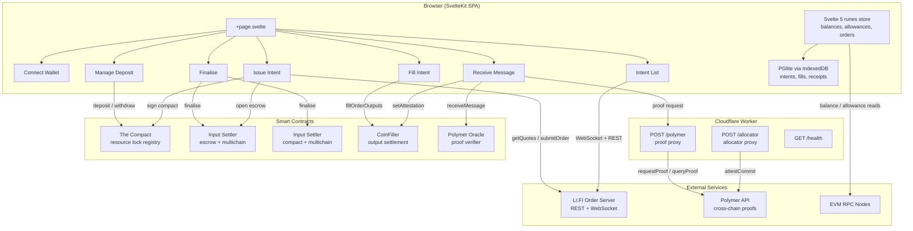

# Lintent

Lintent is LI.FI's interactive demo for the [Open Intents Framework (OIF)](https://openintents.xyz). It walks through the full cross-chain intent lifecycle, from resource lock management and intent issuance to solving, proof submission, and finalisation. The live app is hosted at [lintent.org](https://lintent.org).

The app handles both sides of an intent: the user (intent issuer) and the solver. Each step maps to a dedicated screen so you can follow the entire flow in sequence.

## Stellar ↔ EVM Axelar corridors

Only direct USDC escrow intents are supported, on these Axelar corridors:

- **Mainnet**: Stellar `1201081091099710` ↔ Base `8453` and ↔ Arbitrum `42161`.
- **Testnet**: Stellar `1201081091099711` ↔ Base Sepolia `84532`.

The deployments are public records, matching the order service's
`/api/v1/contracts`, and live in one static table per network
(`AXELAR_NETWORKS` in `src/lib/axelarNetworks.ts`): ABI generation, oracles,
Axelar chain names, Stellar input escrow/output settler, USDC (7 decimals on
Stellar, 6 on EVM), Axelarscan estimator and order API. There is no
environment flag. Pick **Mainnet** or **Testnet** in Asset Management, then a
directional button in Intent Issuance. **Explore without connecting** permits
route/quote-state inspection and historical order reads; it does not create a
wallet or authorize transactions. Freighter must use the selected network's
passphrase.

Quotes come from the network's order API, irrespective of the general API
toggle: `new IntentApi(true)` (`https://order.li.fi`) on both mainnet and
testnet. The accept-list
contains exactly the corridor's two Axelar oracles with `stellar:`/`eip155:`
namespaces. Quote ID/reference, validity, oracle metadata, allowances and exact
`openIntentTx` remain bound to the selection and are saved alongside an executed
local order. Account/network/recipient/assets/amounts/settings changes and expiry
invalidate it; stale responses cannot replace a newer request. No manual-order
nonce, deadline or oracle reconstruction is used for these corridors.

Before signing, the factory checks the requested USDC route/account/amounts,
recipient kind, both settlers/oracles, reference↔nonce, validity and allowance
targets. EVM executes the returned `to/data/value` after the returned allowance
check. Stellar decodes the returned **order ScVal**, calls `open` on the returned
escrow, simulates, then asks Freighter to sign under the selected passphrase;
the API payload is not an envelope. Wallets, RPCs, balances and receipt caches
are network-scoped.

The selection's request generation is revocable. Clearing, replacing, refreshing
or editing it also invalidates pending execution, even if the old amount is
restored. The factory rechecks selection identity/generation and live output
amount before EVM approval/open requests and Freighter signing, after asynchronous
preparation and network checks. Only initial quote selection accepts a pre-quote
output placeholder. Revocation cannot undo an approval/signature already requested.

Catamaran may fill and claim externally. Supply its actual fill transaction hash
in **Fill Intent** to inspect proof progress. Stellar fill events and records
identify the real claimant; reads do not require the connected EVM user to equal
that solver. Stellar claimant commitments are opaque bytes32 values, never
public keys or reconstructed G-addresses. Only the actual fill claimant may
manually finalise. This does not add native REST/WS ingestion or firm-quote
attribution to Catamaran.

Manual proofs depend on the network's oracle ABI generation. The proof
destination is the **origin** chain. Only paid Relayed mode with positive native
gas and zero destination config is supported, and forward/reverse chain maps are
checked before publication.

- **current** (testnet): EVM `submit(string,string,address,bytes[],bytes32,uint8)`
  with the destination's Axelar name and native oracle string (Stellar C-strkey);
  Stellar `submit` with the U256 destination id and the oracle address string.
  Maps: EVM `chainIdMap`/`reverseChainIdMap`, Stellar `route`/`chain_name`.
  Sources: EVM `7dc19ce`; Stellar `dccd29fad348d6058e0a4f97b8672fd94825ad53`.
- **legacy** (mainnet): EVM `submit(string,bytes32,address,bytes[],bytes32,uint8)`
  and Stellar `submit(String,BytesN<32>,…)`, both with the destination's Axelar
  name and the raw 32-byte oracle id (EVM addresses left-padded with 12 zero
  bytes), which the oracle encodes by route kind. Maps: EVM `route(name)` and
  `reverseChainIdMap(id) == keccak256(name)`, Stellar `route(name).chain_id` and
  `chain_name`. Sources: EVM `e226659`; Stellar `5b8f3ca`.

Gas is estimated server-side (`/axelar/gas`) for supported corridors only, via
the network's fixed `POST https://{testnet.}api.axelarscan.io/gmp/estimateGasFeeForNHops`,
`{params:[request],showDetailedFees:true}`. Requests use native oracle strings,
the table's Axelar chain names, zero native-token address,
`gasLimit:"500000"`, `gasMultiplier:"auto"` and hex receiving `execute` data.
Encoding follows Catamaran's `proof/lifecycle/native.rs` and `native_origin.rs`:
EVM calldata or Stellar **Operation XDR**, with estimate-only all-`ff` IDs.
Those IDs never authenticate or submit a proof. The one-hop echo must repeat
every request field, 7/18 native decimals and a positive decimal-string total.
Unavailable estimates disable manual publication; there is no gas floor.
Messages link to the network's Axelarscan.

The SDK is pinned to the published P2 Git commit
`352216efb365c620a1a9dd49cb72116b8faf5b61`; no release or local link is assumed.
Normal `bun install` runs the trusted Git package's `prepare` to generate
`_esm`, `_cjs` and `_types`; no manual SDK build or copied outputs are required.
Bun's in-place Git preparation uses the consumer's build tools, so install with
devDependencies enabled: `rollup ^4.61.0`, `rollup-plugin-esbuild ^6.2.1`,
`typescript ^5.6.3` and `@types/bun ^1.3.8` (compatible newer versions are valid).
The manifest explicitly trusts `@lifi/intent`; preserve other audited trust
entries and do not blanket-approve lifecycle scripts. `bun.lock` pins the exact
Git revision and resolved build tools. Production build stages must install
devDependencies before preparing the SDK and building lintent; a
production-only install from an empty dependency tree omits required tools.

Existing PR pushes create automatic Cloudflare previews; no new deployment
workflow is added.

## Architecture



## Intent Lifecycle

The app exposes six sequential screens, each representing one step in the OIF flow.

- **Connect Wallet** connects via Web3-Onboard (injected wallets, Coinbase, WalletConnect, Zeal)
- **Manage Deposit** lets you choose between escrow and compact locking, then deposit or withdraw tokens from The Compact
- **Issue Intent** configures the intent (input/output tokens, chains, amounts, verifier), fetches a quote from the LI.FI order server, and submits the order on-chain (escrow) or via EIP-712 signature (compact)
- **Intent List** shows open intents from the order server WebSocket and local DB, with the option to import by on-chain order ID
- **Fill Intent** is the solver side, where output tokens are delivered to recipients via the CoinFiller contract on each output chain
- **Receive Message** fetches a cross-chain proof from Polymer and submits it to the Polymer Oracle on the source chain (or calls `setAttestation` for same-chain fills)
- **Finalise** calls `finalise()` on the appropriate input settler, releasing the locked input tokens to the solver

## Tech Stack

- **Framework** SvelteKit 2 with Svelte 5 runes
- **Language** TypeScript
- **Styling** Tailwind CSS v4
- **EVM** viem ~2.45
- **Wallet** Web3-Onboard
- **Local DB** PGlite (WASM Postgres) + Drizzle ORM, persisted to IndexedDB
- **Deployment** Cloudflare Workers via `@sveltejs/adapter-cloudflare`
- **Runtime** Bun
- **Testing** Bun test (unit/integration) and Playwright (E2E)

## Supported Chains

**Mainnet** Ethereum, Base, Arbitrum, Polygon, BSC, MegaETH, Katana

**Testnet** Sepolia, Base Sepolia, Arbitrum Sepolia, Optimism Sepolia

## Smart Contracts

The app interacts with the following deployed contracts (ABIs are inlined in `src/lib/abi/`).

| Contract                | Purpose                                                                              |
| ----------------------- | ------------------------------------------------------------------------------------ |
| The Compact             | ERC-6909 resource lock registry for compact-based intents                            |
| Input Settler (Escrow)  | Opens and finalises escrow-based intents (single-chain and multichain variants)      |
| Input Settler (Compact) | Finalises compact-based intents using combined sponsor and allocator signatures      |
| CoinFiller              | Output settlement where solvers deliver tokens, also handles same-chain attestations |
| Polymer Oracle          | Verifies cross-chain fill proofs submitted via Polymer                               |

## Project Structure

```
src/
  lib/
    abi/              # contract ABIs (Compact, Escrow, CoinFiller, Polymer Oracle, etc.)
    libraries/        # core logic (Intent, IntentFactory, OrderServer, Solver, CompactLib)
    screens/          # SvelteKit components for each step in the flow
    utils/            # helpers (EIP-712 typed data, order validation, address encoding)
    config.ts         # contract addresses, chain config, token lists, RPC clients
    state.svelte.ts   # global reactive store (Svelte 5 runes)
    db.ts             # PGlite + Drizzle init with IndexedDB persistence
    schema.ts         # Drizzle table definitions
  routes/
    +page.svelte      # single-page entry point (renders all six screens)
    polymer/          # server route proxying to Polymer API
    allocator/        # server route proxying to Polymer Allocator
    health/           # liveness check
tests/
  unit/               # order validation, intent list, order server parsing, asset selection
  e2e/                # Playwright browser tests for issuance flow
  db.test.ts          # PGlite integration test
```

## Getting Started

1. Copy `.env.example` to `.env`
2. Create a [WalletConnect](https://walletconnect.com) project and add the project ID
3. Create an account with [Polymer](https://accounts.polymerlabs.org/) and generate API keys for mainnet and testnet
4. Install dependencies with `bun install`
5. Start the dev server with `bun run dev`

## Testing

- `bun run test:unit` runs library and unit tests with coverage
- `bun run test:e2e` runs Playwright browser tests (requires `bunx playwright install chromium`)
- `bun run test:all` runs both suites

## Deployment

Production deploys happen on push to `main` via GitHub Actions. The workflow builds with Bun and deploys to the `lintent-worker` Cloudflare Worker. PR preview environments are created and cleaned up automatically.

Required secrets for CI: `CLOUDFLARE_API_TOKEN`, `CLOUDFLARE_ACCOUNT_ID`, `PRIVATE_POLYMER_MAINNET_ZONE_API_KEY`, `PRIVATE_POLYMER_TESTNET_ZONE_API_KEY`, `PUBLIC_WALLET_CONNECT_PROJECT_ID`.

## License

This project is licensed under the [MIT License](/LICENSE).
