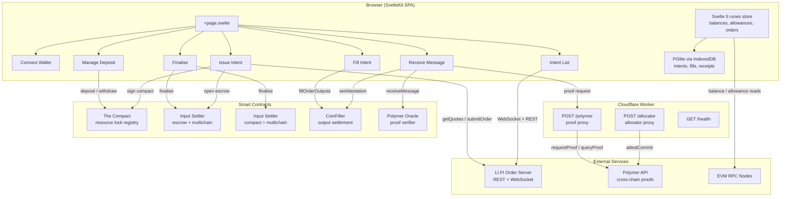

# Lintent

Lintent is LI.FI's interactive demo for the [Open Intents Framework (OIF)](https://openintents.xyz). It walks through the full cross-chain intent lifecycle, from resource lock management and intent issuance to solving, proof submission, and finalisation. The live app is hosted at [lintent.org](https://lintent.org).

The app handles both sides of an intent: the user (intent issuer) and the solver. Each step maps to a dedicated screen so you can follow the entire flow in sequence.

The Axelar mainnet identities in `src/lib/config.ts` are historical, old-ABI
deployments. This release keeps their order reads and existing refund paths,
but rejects new Axelar issuance, manual publication and claims against them.
Unrelated Polymer/non-Axelar routes are unchanged.

## Stellar Testnet ↔ Base Sepolia (disabled by default)

Only direct USDC escrow intents are supported: Stellar `1201081091099711`
(7 decimals, SAC `CBIELTK6YBZJU5UP2WWQEUCYKLPU6AUNZ2BQ4WWFEIE3USCIHMXQDAMA`)
↔ Base Sepolia `84532` (6 decimals,
`0x036CbD53842c5426634e7929541eC2318f3dCF7e`). Choose **Testnet** in Asset
Management, then either directional button in Intent Issuance. **Explore without
connecting** permits route/quote-state inspection and historical order reads;
it does not create a wallet or authorize transactions. Freighter must use
`Test SDF Network ; September 2015`, not Mainnet.

Supply these **public**, non-secret environment values through the existing
SvelteKit dynamic-public configuration:

- `PUBLIC_STELLAR_TESTNET_ENABLED`: literal `true` or `false`; absent means false.
- `PUBLIC_STELLAR_TESTNET_DEPLOYMENT_JSON`: the exact normalized P1 handoff:

```ts
type StellarBaseSepoliaDeployment = {
  schemaVersion: 1;
  corridor: "stellar-testnet-base-sepolia";
  addressProvenance: "predicted" | "deployment-record";
  stellar: { inputEscrow: string; outputSettler: string; axelarOracle: string };
  baseSepolia: { axelarOracle: string };
};
```

No application deployment addresses are invented here. All four fields are
required, nonzero contracts. The validator rejects unknown fields, wrong
schema/corridor, G-addresses in contract roles, all four known Stellar mainnet
deployments and the Base mainnet application oracle. EVM lowercase and valid
checksummed addresses are accepted; the handoff normalizes EVM to lowercase.
Malformed supplied data is an explicit UI configuration error, even when
disabled. Enabling without complete `deployment-record` data fails closed.
`predicted` is accepted only with the corridor disabled for offline preparation.
The provenance label is operator-supplied, not evidence of deployment.

Both directions always request `https://order-dev.li.fi/api/v1/integrator/quote/request`
via `new IntentApi(false)`, irrespective of the general API toggle. The accept-list
contains exactly the two configured Axelar oracles with `stellar:`/`eip155:`
namespaces. Quote ID/reference, validity, oracle metadata, allowances and exact
`openIntentTx` remain bound to the selection and are saved alongside an executed
local order. Account/network/recipient/assets/amounts/settings changes and expiry
invalidate it; stale responses cannot replace a newer request. No manual-order
nonce, deadline or oracle reconstruction is used for this corridor.

Before signing, the factory checks the requested USDC route/account/amounts,
recipient kind, both settlers/oracles, reference↔nonce, validity and allowance
targets. EVM executes the returned `to/data/value` after the returned allowance
check. Stellar decodes the returned **order ScVal**, calls `open` on the returned
escrow, simulates, then asks Freighter to sign under the selected passphrase;
the API payload is not an envelope. Wallets, RPCs, balances and receipt caches
are network-scoped.

Catamaran may fill and claim externally. Supply its actual fill transaction hash
in **Fill Intent** to inspect proof progress. Stellar fill events and records
identify the real claimant; reads do not require the connected EVM user to equal
that solver. Stellar claimant commitments are opaque bytes32 values, never
public keys or reconstructed G-addresses. Only the actual fill claimant may
manually finalise. This does not add native REST/WS ingestion or firm-quote
attribution to Catamaran.

Manual proofs use the pinned latest EVM
`submit(uint256,string,address,bytes[],bytes32,uint8)` and Stellar U256/String
arguments. The proof destination is the **origin** numeric domain and its
native oracle string. Forward/reverse chain maps are checked before publication.
Only paid Relayed mode with positive native gas and zero destination config is
supported. Contract sources: EVM `25b2a0114d4ab0255b899bc49e009a4e0a35d1a7`;
Stellar `dccd29fad348d6058e0a4f97b8672fd94825ad53`.

The server estimates only this configured pair through
`POST https://testnet.api.axelarscan.io/gmp/estimateGasFeeForNHops`,
`{params:[request],showDetailedFees:true}`. Requests use native oracle strings,
provider names `stellar-2026-q1-2`/`base-sepolia`, zero native-token address,
`gasLimit:"500000"`, `gasMultiplier:"auto"` and hex receiving `execute` data.
Encoding follows Catamaran's `proof/lifecycle/native.rs` and `native_origin.rs`:
EVM calldata or Stellar **Operation XDR**, with estimate-only all-`ff` IDs.
Those IDs never authenticate or submit a proof. One-hop echo, 7/18 native
decimals and positive decimal-string totals must match. Unavailable estimates
disable manual publication; there is no testnet gas floor. Existing mainnet
estimation remains separate. Testnet messages link to testnet Axelarscan.

The SDK is pinned to the published P2 Git commit
`398f9730835cf869858d7e4dc6212e9c789827ce`; no release or local link is assumed.
Its normal Git `prepare` produces `_esm`, `_cjs` and `_types`. In this worktree
Bun 1.4.2's in-place Git preparation failed (Rollup's TypeScript plugin excludes
`node_modules`). A real remote Git install with
`npm install --legacy-peer-deps --package-lock=false --foreground-scripts --no-audit --no-fund`
did prepare and install those exports; Bun then ran the consumer checks.
The npm flag accommodates the existing MetaMask optional-peer conflict, not a
dependency downgrade. `bun.lock` remains authoritative; no npm lock is committed.
A Bun-only clean install/automatic preview must not be claimed ready until that
Git-prepare limitation is resolved upstream or in the install toolchain.

Activation still requires D1–D4: real deployments/fingerprints and owner maps,
funded/trustlined wallets, durable ingestion, network-scoped Order configuration
and solver registration, an isolated latest-ABI Catamaran instance with verified
resources/routes, then intentional route enablement/quote unpausing. P4/P7's
frozen interfaces are not runtime-readiness evidence. No live quote, RPC,
signature, funded flow, preview deployment or activation is verified by the
offline synthetic preparation checks. Existing PR pushes still create automatic
Cloudflare previews; no new deployment workflow is added.

## Architecture



## Intent Lifecycle

The app exposes six sequential screens, each representing one step in the OIF flow.

- **Connect Wallet** connects via Web3-Onboard (injected wallets, Coinbase, WalletConnect, Zeal)
- **Manage Deposit** lets you choose between escrow and compact locking, then deposit or withdraw tokens from The Compact
- **Issue Intent** configures the intent (input/output tokens, chains, amounts, verifier), fetches a quote from the LI.FI order server, and submits the order on-chain (escrow) or via EIP-712 signature (compact)
- **Intent List** shows open intents from the order server WebSocket and local DB, with the option to import by on-chain order ID
- **Fill Intent** is the solver side, where output tokens are delivered to recipients via the CoinFiller contract on each output chain
- **Receive Message** fetches a cross-chain proof from Polymer and submits it to the Polymer Oracle on the source chain (or calls `setAttestation` for same-chain fills)
- **Finalise** calls `finalise()` on the appropriate input settler, releasing the locked input tokens to the solver

## Tech Stack

- **Framework** SvelteKit 2 with Svelte 5 runes
- **Language** TypeScript
- **Styling** Tailwind CSS v4
- **EVM** viem ~2.45
- **Wallet** Web3-Onboard
- **Local DB** PGlite (WASM Postgres) + Drizzle ORM, persisted to IndexedDB
- **Deployment** Cloudflare Workers via `@sveltejs/adapter-cloudflare`
- **Runtime** Bun
- **Testing** Bun test (unit/integration) and Playwright (E2E)

## Supported Chains

**Mainnet** Ethereum, Base, Arbitrum, Polygon, BSC, MegaETH, Katana

**Testnet** Sepolia, Base Sepolia, Arbitrum Sepolia, Optimism Sepolia

## Smart Contracts

The app interacts with the following deployed contracts (ABIs are inlined in `src/lib/abi/`).

| Contract                | Purpose                                                                              |
| ----------------------- | ------------------------------------------------------------------------------------ |
| The Compact             | ERC-6909 resource lock registry for compact-based intents                            |
| Input Settler (Escrow)  | Opens and finalises escrow-based intents (single-chain and multichain variants)      |
| Input Settler (Compact) | Finalises compact-based intents using combined sponsor and allocator signatures      |
| CoinFiller              | Output settlement where solvers deliver tokens, also handles same-chain attestations |
| Polymer Oracle          | Verifies cross-chain fill proofs submitted via Polymer                               |

## Project Structure

```
src/
  lib/
    abi/              # contract ABIs (Compact, Escrow, CoinFiller, Polymer Oracle, etc.)
    libraries/        # core logic (Intent, IntentFactory, OrderServer, Solver, CompactLib)
    screens/          # SvelteKit components for each step in the flow
    utils/            # helpers (EIP-712 typed data, order validation, address encoding)
    config.ts         # contract addresses, chain config, token lists, RPC clients
    state.svelte.ts   # global reactive store (Svelte 5 runes)
    db.ts             # PGlite + Drizzle init with IndexedDB persistence
    schema.ts         # Drizzle table definitions
  routes/
    +page.svelte      # single-page entry point (renders all six screens)
    polymer/          # server route proxying to Polymer API
    allocator/        # server route proxying to Polymer Allocator
    health/           # liveness check
tests/
  unit/               # order validation, intent list, order server parsing, asset selection
  e2e/                # Playwright browser tests for issuance flow
  db.test.ts          # PGlite integration test
```

## Getting Started

1. Copy `.env.example` to `.env`
2. Create a [WalletConnect](https://walletconnect.com) project and add the project ID
3. Create an account with [Polymer](https://accounts.polymerlabs.org/) and generate API keys for mainnet and testnet
4. Install dependencies with `bun install`
5. Start the dev server with `bun run dev`

## Testing

- `bun run test:unit` runs library and unit tests with coverage
- `bun run test:e2e` runs Playwright browser tests (requires `bunx playwright install chromium`)
- `bun run test:all` runs both suites

## Deployment

Production deploys happen on push to `main` via GitHub Actions. The workflow builds with Bun and deploys to the `lintent-worker` Cloudflare Worker. PR preview environments are created and cleaned up automatically.

Required secrets for CI: `CLOUDFLARE_API_TOKEN`, `CLOUDFLARE_ACCOUNT_ID`, `PRIVATE_POLYMER_MAINNET_ZONE_API_KEY`, `PRIVATE_POLYMER_TESTNET_ZONE_API_KEY`, `PUBLIC_WALLET_CONNECT_PROJECT_ID`.

## License

This project is licensed under the [MIT License](/LICENSE).
