# Lintent

Lintent is LI.FI's interactive demo for the [Open Intents Framework (OIF)](https://openintents.xyz). It walks through the full cross-chain intent lifecycle, from resource lock management and intent issuance to solving, proof submission, and finalisation. The live app is hosted at [lintent.org](https://lintent.org).

The app handles both sides of an intent: the user (intent issuer) and the solver. Each step maps to a dedicated screen so you can follow the entire flow in sequence.

## Architecture

```mermaid
flowchart TD
    subgraph Browser["Browser (SvelteKit SPA)"]
        direction TB
        Page["+page.svelte"]
        S0["Connect Wallet"]
        S1["Manage Deposit"]
        S2["Issue Intent"]
        S3["Intent List"]
        S4["Fill Intent"]
        S5["Receive Message"]
        S6["Finalise"]
        R["/refund\nself-serve refund page"]

        Store["Svelte 5 runes store\nbalances, allowances, orders"]
        DB["PGlite via IndexedDB\nintents, fills, receipts"]

        Page --> S0 & S1 & S2 & S3 & S4 & S5 & S6
        Store --> DB
    end

    subgraph Worker["Cloudflare Worker"]
        API_P["POST /polymer\nproof proxy"]
        API_A["POST /allocator\nallocator proxy"]
        API_H["GET /health"]
    end

    subgraph External["External Services"]
        OS["LI.FI Order Server\nREST + WebSocket"]
        POL["Polymer API\ncross-chain proofs"]
        WHSCAN["Wormhole Scan\nsigned VAA retrieval"]
        RPC["EVM RPC Nodes"]
    end

    subgraph Contracts["Smart Contracts"]
        COMPACT["The Compact\nresource lock registry"]
        ESC["Input Settler\nescrow + multichain"]
        CSETT["Input Settler\ncompact + multichain"]
        CF["CoinFiller\noutput settlement"]
        PORACLE["Polymer Oracle\nproof verifier"]
        WORACLE["Wormhole Oracle\nEVM contract / Solana state PDA"]
        WCORE["Wormhole Core\npublication + guardian verification"]
    end

    S2 -->|"getQuotes / submitOrder"| OS
    S3 -->|"WebSocket + REST"| OS
    S4 -->|"fillOrderOutputs"| CF
    S5 -->|"proof request"| API_P
    S5 -->|"receiveMessage"| PORACLE
    S5 -->|"setAttestation"| CF
    S5 -->|"publish fill / register VAA"| WORACLE
    S5 -->|"retrieve signed VAA"| WHSCAN
    WORACLE -->|"publish / verify"| WCORE
    S6 -->|"finalise"| ESC
    R -->|"order status lookup"| OS
    R -->|"proof request"| API_P
    R -->|"refund / refundOnNonFill"| ESC
    R -->|"emitNotFilled"| CF
    R -->|"publish non-fill / register VAA"| WORACLE
    R -->|"retrieve signed VAA"| WHSCAN
    S6 -->|"finalise"| CSETT
    S1 -->|"deposit / withdraw"| COMPACT
    S2 -->|"open escrow"| ESC
    S2 -->|"sign compact"| COMPACT
    API_P -->|"requestProof / queryProof"| POL
    API_A -->|"attestCommit"| POL
    Store -->|"balance / allowance reads"| RPC
```



## Intent Lifecycle

The app exposes six sequential screens, each representing one step in the OIF flow.

- **Connect Wallet** connects an EVM wallet through wagmi, TronLink for Tron, or a supported Solana wallet adapter. Cross-namespace flows can require two wallets.
- **Manage Deposit** lets you choose between escrow and compact locking, then deposit or withdraw tokens from The Compact
- **Issue Intent** configures the intent (input/output tokens, chains, amounts, verifier), fetches a quote from the LI.FI order server, and submits the order on-chain (escrow) or via EIP-712 signature (compact)
- **Intent List** shows open intents from the order server WebSocket and local DB, with the option to import by on-chain order ID
- **Fill Intent** is the solver side, where output tokens are delivered to recipients via the CoinFiller contract on each output chain
- **Receive Message** dispatches from the order's recorded oracle: Polymer keeps its existing proof path; Wormhole publishes the exact fill on the output chain, retrieves its signed VAA, then registers it on each input chain. Same-chain fills retain the settler path.
- **Finalise** calls `finalise()` on the appropriate input settler, releasing the locked input tokens to the solver

## Wormhole Routes and Proofs

Polymer remains the default verifier. Select **Wormhole** for a remote route; same-chain issuance displays **Settler** instead. Deployment candidates in `src/lib/config.ts` are not a support guarantee: issuance checks actual RPC/cluster identity, executable deployments, configured Core, native Wormhole chain IDs and exact origin mappings before approval, opening or signing. Multichain inputs must share the recorded oracle address, and every input must accept every remote output.

Wormhole outputs name their destination-specific oracle. Solana uses the Wormhole **state PDA** as emitter and consumer, not the program ID. Tron, Solana devnet and chains without compatible deployments or mappings are blocked for Wormhole; their existing Polymer and same-chain behavior is unchanged. Failed readiness reads remain retryable.

Remote Wormhole quotes use the order service's v1 native deployment constraints on both sides. The installed intent SDK does not forward oracle filters, so the app sends these constrained requests directly. Missing or mismatched response oracle metadata is discarded. Changing verifier invalidates the previous amount, solver and issuance eligibility; a missing Wormhole quote stays **No Quote**, never a Polymer fallback.

Publication signs on the **output chain**, with the current EVM Core fee or the Solana contract's own Core fee transfer. Signed VAAs come directly from Wormhole Scan's fixed mainnet/testnet endpoints, without an API key or proxy. Before delivery, the app binds emitter chain/address, uint64 sequence, nonce, consistency, application and exact tagged fill/non-fill payload. Parsing is not guardian signature verification: the receiving EVM oracle or Solana Core performs that verification.

**Check again** resumes the same publication while guardians are pending. Shared best-effort local hints contain only public transaction/message locators, never private keypairs, proof bytes or trusted eligibility. Hints are revalidated against chain data; consumed Solana records require publication recovery, not another consume. An existing origin proof skips publication and delivery spends. On Solana, delivery may require guardian-verification transactions, Core VAA posting and oracle registration. Confirmed intermediates are resumable but do not mark the proof complete. Unfinished signature sets are reused only in the same session; reloading before VAA posting can incur rent again.

Only confirmed origin attestation state completes proof submission. Settlement remains provider-independent and uses the original fill's solver and timestamp.

## Refund Page

`/refund` (`src/routes/refund/`) lets anyone look up an escrow order by its on-chain order id or by the transaction that opened it (EVM/Tron hash or Solana signature) and refund it to the order's user. Every write is permissionless and pays out to `order.user`; the sender only pays gas. `?order=<input>` resumes the page, and every step is re-derived from chain state on load.

- **Supported** escrow orders on lintent's mainnet chains, EVM, Tron and Solana, as origin or destination. Compact, multichain, unknown-settler and unregistered-chain orders show their status but no action.
- **Slow refund** calls `refund(order)` once `expires` has passed (Solana → Solana waits an extra 900s).
- **Fast refund** starts strictly after the fill deadline, with every signed output explicitly readable and unfilled and more than 2h remaining before `expires`. Its top-level steps stay **record → prove → refund**. Polymer retains `emitNotFilled` or Solana `attest_not_filled` + `submit_consume`, Polymer proof delivery and `refundOnNonFill`. Wormhole publishes the signed non-fill payload on the destination, waits for guardians, verifies/posts/registers the VAA on the origin, then calls the same permissionless refund executor. A new Solana non-fill record must be minted within the finalized 48h window, with a 600s safety margin.
- **Not refundable** when any output is filled, missing or unreadable; known Delivered/Settled or delivery/settlement transaction metadata also vetoes spending. Claimed, refunded and settled escrows are terminal. Wormhole actions re-read complete eligibility after wallet preparation and immediately before every publication, Core stage, proof registration and final refund. A proof already registered permits finish-only behavior inside the start buffer.

Slow refund does not require Wormhole route availability, Scan or a VAA. Read failures retain the snapshot for display but disable actions until a fresh successful read; terminal orders clear only their own recovery hints.

States: not opened · waiting for the fill deadline · waiting for expiry (with the reason fast is unavailable) · fast refund (record / prove / refund) · refundable now · refunded · claimed · settled · filled · fill unverifiable · not refundable here.

## Tech Stack

- **Framework** SvelteKit 2 with Svelte 5 runes
- **Language** TypeScript
- **Styling** Tailwind CSS v4
- **EVM** viem ~2.45
- **Wallets** wagmi EVM connectors, TronLink and Solana wallet adapters
- **Local DB** PGlite (WASM Postgres) + Drizzle ORM, persisted to IndexedDB
- **Deployment** Cloudflare Workers via `@sveltejs/adapter-cloudflare`
- **Runtime** Bun
- **Testing** Bun test (unit/integration) and Playwright (E2E)

## Supported Chains

**Mainnet** Ethereum, Base, Arbitrum, Polygon, BSC, MegaETH, Katana

**Testnet** Sepolia, Base Sepolia, Arbitrum Sepolia, Optimism Sepolia

## Smart Contracts

The app interacts with the following deployed contracts (ABIs are inlined in `src/lib/abi/`).

| Contract                | Purpose                                                                                     |
| ----------------------- | ------------------------------------------------------------------------------------------- |
| The Compact             | ERC-6909 resource lock registry for compact-based intents                                   |
| Input Settler (Escrow)  | Opens and finalises escrow-based intents (single-chain and multichain variants)             |
| Input Settler (Compact) | Finalises compact-based intents using combined sponsor and allocator signatures             |
| CoinFiller              | Output settlement where solvers deliver tokens, also handles same-chain attestations        |
| Polymer Oracle          | Verifies cross-chain fill proofs submitted via Polymer                                      |
| Wormhole Oracle / Core  | Publishes tagged fill/non-fill messages and verifies guardian-signed VAAs on EVM and Solana |

## Project Structure

```
src/
  lib/
    abi/              # contract ABIs (Compact, Escrow, CoinFiller, Polymer Oracle, etc.)
    libraries/        # core logic (Intent, IntentFactory, OrderServer, Solver, CompactLib)
    screens/          # SvelteKit components for each step in the flow
    utils/            # helpers (EIP-712 typed data, order validation, address encoding)
    config.ts         # contract addresses, chain config, token lists, RPC clients
    state.svelte.ts   # global reactive store (Svelte 5 runes)
    db.ts             # PGlite + Drizzle init with IndexedDB persistence
    schema.ts         # Drizzle table definitions
  routes/
    +page.svelte      # single-page entry point (renders all six screens)
    refund/           # self-serve refund page (slow + fast refund)
    polymer/          # server route proxying to Polymer API
    allocator/        # server route proxying to Polymer Allocator
    health/           # liveness check
tests/
  unit/               # order validation, intent list, order server parsing, asset selection
  e2e/                # Playwright browser tests for issuance flow
  db.test.ts          # PGlite integration test
```

## Getting Started

1. Copy `.env.example` to `.env`
2. Create a [WalletConnect](https://walletconnect.com) project and add the project ID
3. Create an account with [Polymer](https://accounts.polymerlabs.org/) and generate API keys for mainnet and testnet
4. Install dependencies with `bun install`
5. Start the dev server with `bun run dev`

## Testing

- `bun run test:unit` runs library and unit tests with coverage
- `bun run test:e2e` runs Playwright browser tests (requires `bunx playwright install chromium`)
- `bun run test:all` runs both suites

## Deployment

Production deploys happen on push to `main` via GitHub Actions. The workflow builds with Bun and deploys to the `lintent-worker` Cloudflare Worker. PR preview environments are created and cleaned up automatically.

Required secrets for CI: `CLOUDFLARE_API_TOKEN`, `CLOUDFLARE_ACCOUNT_ID`, `PRIVATE_POLYMER_MAINNET_ZONE_API_KEY`, `PRIVATE_POLYMER_TESTNET_ZONE_API_KEY`, `PUBLIC_WALLET_CONNECT_PROJECT_ID`.

## License

This project is licensed under the [MIT License](/LICENSE).
